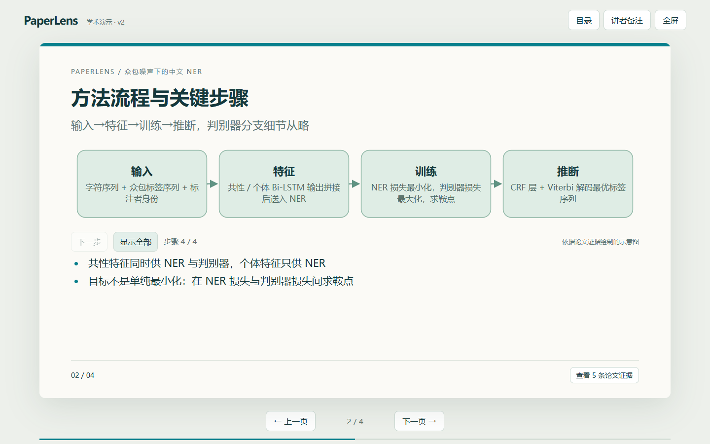
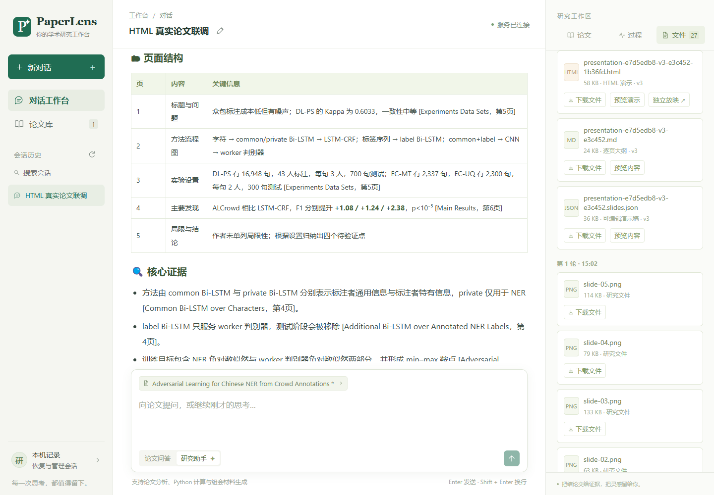
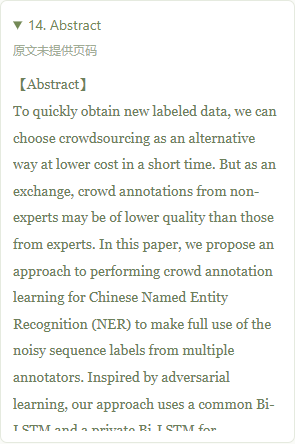
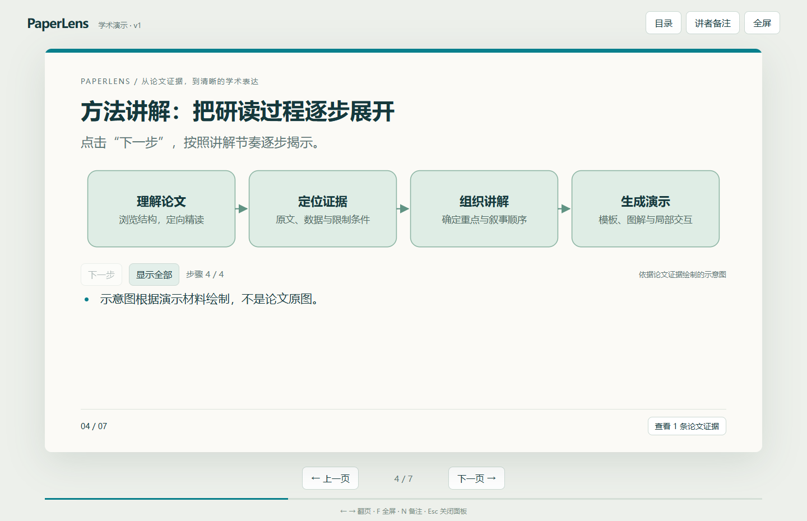

# PaperLens

面向论文研读与组会汇报的 AI Agent：从有来源的连续问答，到可编辑、可离线放映的 HTML 演示。

**使用场景：** 上传论文 PDF → 根据原文理解问题与方法 → 整理汇报大纲 → 生成演示 → 通过对话修改指定页面。

[安装运行](docs/setup.md) · [工具与架构设计](docs/html-agent-design.md) · [真实链路与复现记录](docs/reproducibility.md)

## 1 分 41 秒演示

[](docs/assets/paperlens-demo.mp4)

[观看 / 下载 MP4](docs/assets/paperlens-demo.mp4) · [演示流程、截图与解说稿](docs/demo.md)

视频使用最新 PaperLens 的真实界面与服务，展示上传、证据问答、4 页演示生成、仅修改方法页标题和离线下载。中文字幕、无配音；等待片段已标注加速，放映镜头来自同次任务的实际产物，不作为运行耗时基准。

## 界面与成果

### 对话、会话历史与生成文件



工作台截图来自真实模型与 RAG 联调保存的会话。画面中的实验数值属于所研读论文，不是本系统的性能指标。

<table>
  <tr>
    <th width="36%">引用溯源 · 真实会话</th>
    <th width="64%">HTML 演示 · 离线功能示例</th>
  </tr>
  <tr>
    <td valign="top"><a href="docs/assets/citations.png"></a></td>
    <td valign="top"><a href="docs/assets/presentation.png"></a><p>使用稳定模板与可配置图解，支持翻页、流程逐步展开、数据表切换、讲者备注和引用查看。此图使用模拟材料，不代表真实论文实验。</p></td>
  </tr>
</table>

**直接体验：** 下载仓库后，用浏览器打开 [examples/presentation.html](examples/presentation.html)。离线示例无需 API Key、模型服务或安装依赖。[截图与架构图来源](docs/assets/README.md)

## 系统架构与工具设计



主 Agent 负责目标理解和工具选择，规划子 Agent 负责论文研究与逐页内容。演示内容保存在结构化稿中，由程序渲染为 HTML；检查结果返回主 Agent，决定是否继续修订。渲染与检查仍是主 Agent 可分别调用的工具，用户只要大纲时可以在规划后结束。[Mermaid 架构图源文件](docs/assets/architecture.mmd)

| 工具能力域 | 工具 | 解决的问题 |
| --- | --- | --- |
| 论文访问 | `inspect_paper` / `search_paper` / `read_paper` | 先看整体结构，再检索证据、定向精读 |
| 计算 | `execute_python` | 在 Docker 沙箱中计算、绘图和生成数据文件 |
| 会话工作区 | `list_artifacts` / `read_artifact` | 发现和读取先前成果，支持连续追问与版本复用 |
| 演示构建 | `plan_presentation` / `render_presentation` / `preview_presentation` | 将规划、生成和反馈拆成可观察、可修改的步骤 |

RAG 服务使用 Grobid 解析 PDF，结合稠密向量检索、BM25、RRF 融合与 Rerank 返回证据。每份演示保留 `.slides.json`、Markdown 大纲和离线 HTML；后续修改通过局部更新保留未涉及的页面与历史版本。

## 我的职责与 Codex 协作

这是围绕个人论文研读和组会汇报需求推进的项目，使用 Codex 协作开发。

| 工作 | 我的参与 | Codex 的帮助 |
| --- | --- | --- |
| 需求与产品流程 | 提出论文问答、组会汇报场景，明确以对话为主，并支持会话历史、连续追问和统一入口 | 梳理接口、状态和实现方案，辅助完成前后端功能 |
| 工具与演示方案 | 参与工具能力划分，推动从 PPT 调整为稳定模板下的 HTML，并讨论规划、渲染和检查的分工 | 将讨论方案落实为工具封装、结构化稿、模板与浏览器检查流程 |
| 联调与迭代 | 使用 PowerShell、Swagger 手动走通链路，反馈会话、任务、SSE 和页面使用问题 | 协助定位问题、修改代码，并编写自动回归与复现脚本 |
| 机制理解与文档 | 梳理工具层、混合检索和上下文机制，整理使用流程与项目表达 | 辅助解释实现、添加代码注释、整理设计与测试文档 |

一个具体迭代是把演示拆成“结构化规划 → 模板渲染 → 浏览器检查”：大纲可以先讨论，页面问题可以反馈，用户要求修改一处时可以复用已有稿件。真实联调已验证仅修改方法页标题，并逐字段确认其他页面、顺序、听众和时长保持不变。

## 安装与运行

### 先体验模拟工作台

Windows PowerShell，在仓库根目录执行：

```powershell
py -3.12 -m venv .venv
.\.venv\Scripts\python.exe -m pip install -r requirements-dev.txt -c requirements-lock.txt
.\.venv\Scripts\python.exe scripts\manage.py demo
```

访问 `http://127.0.0.1:18192/`。该模式使用固定论文与模拟模型响应，适合查看交互；真实论文问答和生成请运行完整服务。Linux 对应命令和环境说明见 [安装手册](docs/setup.md)。

### 运行完整服务

1. 按 [安装手册](docs/setup.md) 创建 Agent、RAG 两个 Python 3.12 环境，用 `manage.py init` 初始化配置。
2. 填写模型 API Key 和可用模型名称，准备 Grobid、Qdrant、Embedding 与 Reranker；可使用已有远程模型服务。
3. 检查依赖，并在不同终端中启动两个 API：

```powershell
.\.venv\Scripts\python.exe scripts\manage.py doctor --services
.\scripts\start-rag.cmd
# 另一个终端：
.\scripts\start-agent.cmd
```

工作台默认地址为 `http://127.0.0.1:18091/`，Agent Swagger 为 `/docs`，RAG 默认地址为 `http://127.0.0.1:18081/`。两个 API 可运行于 Windows 或 Linux；本地 GPU 模型服务使用 Linux/WSL，解释器、端口和模型位置均可配置。

## 已完成能力与验证

| 能力 | 当前状态 |
| --- | --- |
| PDF 入库、证据问答与原文读取 | 已完成真实服务联调 |
| 会话历史、上下文持久化、连续追问与刷新恢复 | 已实现，并有后端和浏览器回归 |
| SSE 执行事件、引用展示、文件预览与下载 | 已实现；SSE 推送执行进度，最终回答完成后整体返回 |
| 演示规划、HTML 渲染、浏览器反馈与局部修订 | 已完成真实生成及后续修改验证 |
| 依赖配置与干净目录安装 | 两个全新 CPU API 环境已安装、启动；GPU 环境和权重复用已有配置 |

**本地验证记录（2026-11-03）：** 47 项 Agent 后端与配置测试、57 项 RAG 测试、7 组 HTML 工作台浏览器检查通过；真实链路完成了论文入库、5 页演示生成和同会话局部修改。数据与方法见 [复现记录](docs/reproducibility.md)，测试覆盖和边界见 [验证说明](docs/verification.md)。

安装对应开发依赖后运行：

```powershell
# Agent：模拟模型与 RAG，无需真实 API Key
.\.venv\Scripts\python.exe -B -m unittest discover -s tests -v

# RAG：使用自己的环境与工作目录
Push-Location rag_service
.\.venv\Scripts\python.exe -B -m pytest tests -q
Pop-Location

# 离线 HTML：需要 Edge 或 Playwright Chromium
.\.venv\Scripts\python.exe -B scripts\check-example.py
```

逐步操作、Swagger 和浏览器测试方法见 [测试手册](docs/html-testing-guide.md)。

## 当前限制

- 当前以单篇论文研读、本地单用户使用为主；`user_id` 是会话归属标识，尚无生产级登录认证。
- PDF 中公式和复杂排版可能产生不完整或异常片段，需要回查原文；尚未提供原论文图片自动提取，方法图主要是依据证据绘制的示意图。
- 浏览器规则检查覆盖运行、布局溢出和交互，不代表审美质量或学术结论已获人工审核；尚无系统性的检索消融与效果基准。
- 服务重启会保留已完成会话及成果，运行中的任务标为中断，需要显式重试。
- 干净目录复现不等于所有机器均已验证；全新 GPU 环境安装、驱动兼容与权重下载仍取决于实际硬件和网络。

## 源码与文档导航

```text
app/          主 Agent、会话任务、演示构建与前端工作台
rag_service/  论文解析、检索、原文访问与重排序服务
tests/        Agent 后端和浏览器测试
examples/     离线演示及结构化示例稿
scripts/      配置、环境检查、启动与通用验证
docs/         设计、接口、操作、复现记录与展示素材
```

- [工具分工与演示设计](docs/html-agent-design.md)
- [跨机器安装与运行](docs/setup.md)
- [会话、任务和文件接口](docs/session-api.md)
- [启动、Swagger 与测试手册](docs/html-testing-guide.md)
- [干净目录复现记录](docs/reproducibility.md)
- [演示视频与作品说明](docs/demo.md)

## 许可与来源

原创代码与文档采用 [MIT 许可](LICENSE)，允许学习、修改及商业使用，分发时需保留版权和许可声明。第三方依赖、模型以及演示中引用的论文内容保留各自的许可和权利，详见 [第三方声明](THIRD_PARTY_NOTICES.md)。
