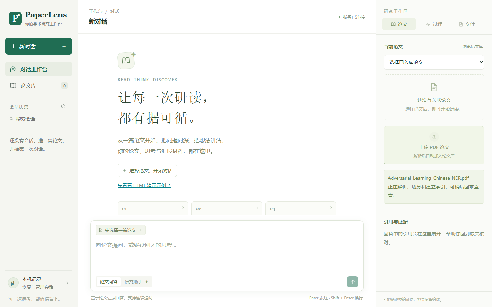
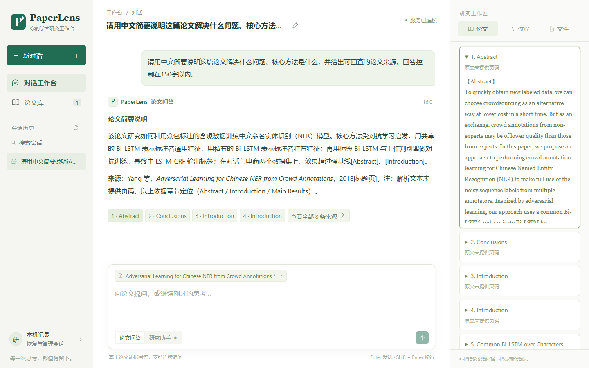
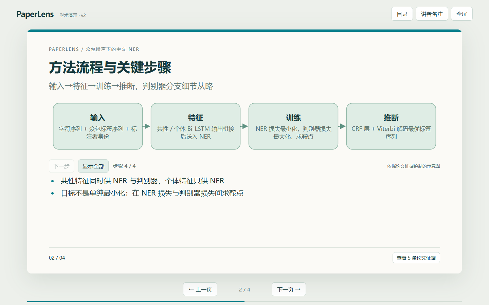

# PaperLens 演示作品

## 直接查看

- [演示视频 MP4](assets/paperlens-demo.mp4)：1 分 41 秒，1440 × 900，H.264，中文字幕，无配音。下载后可用本地播放器直接打开。
- [离线交互示例](../examples/presentation.html)：下载后用浏览器打开，无需模型或服务。此示例保持原有模拟材料，便于独立体验图解、翻页和引用交互。

视频录制日期：2026-11-03，使用当前 PaperLens 发布副本。在独立会话、数据库与向量集合中，通过浏览器自动化完成真实操作；没有替换问题、回答、任务状态或生成结果。

## 视频内容

| 时间 | 内容 |
| --- | --- |
| 00:00–00:05 | 项目与使用场景 |
| 00:05–00:19 | 上传 PDF，解析并建立检索索引 |
| 00:19–00:39 | 对研究问题和方法提问，展开实际原文来源 |
| 00:39–01:06 | 切换研究助手，生成 4 页 HTML 并查看方法图解 |
| 01:06–01:28 | 在同一会话中只修改方法页标题，生成新版 |
| 01:28–01:41 | 下载 HTML、离线交互与总结 |

原始主流程录制约 4 分 38 秒，成片经过剪辑；模型等待画面加速，相关片段显示加速标记。为了完整展示标题与页面，初版和修订版的放映镜头从同次任务实际生成的 HTML 中离线补拍。视频展示功能流程，不用于比较模型速度或系统性能。

## 本次实际验证

- 上传与入库使用真实 Grobid、Embedding 和 Qdrant 服务。
- 论文问答、演示生成与后续修改共 3 次真实 Agent 任务，均完成。
- 初版与修订版各 4 页，两次浏览器规则检查均通过。
- 程序逐字段核对：只有指定方法页的标题变化，其余页面、顺序、听众和时长保持不变。
- 下载后断开浏览器网络，HTML 仍能翻页和展开图解。

素材中的实验内容来自所研读论文，不是 PaperLens 的效果指标。规则检查不等同于对学术事实的人工审核。论文 PDF、原始会话数据、模型权重与访问凭据没有放入公开素材。

## 关键截图

### 上传与入库

### 问答与证据

### 连续追问后的新版

## 可选口播稿

下面的稿件可用于自行配音或面试现场讲解，无需重新录制界面：

> 这是我使用 Codex 协作开发的 PaperLens，面向论文研读和组会汇报。首先上传论文，系统完成解析和入库。随后我对研究问题和核心方法提问，回答会提供可回查的章节与原文。切换研究助手后，可以把论文组织为结构化演示稿，再用稳定模板生成 HTML。这里能查看执行过程、方法图解和证据。接着在同一会话中要求只修改方法页标题，Agent 会复用已有稿件生成新版，其他页面保持不变。最后将 HTML 下载到本地，仍能离线翻页和交互。项目中我负责需求、方案讨论和手动联调，Codex 辅助代码实现、排错、测试和文档。视频对模型等待时间做了加速处理。
